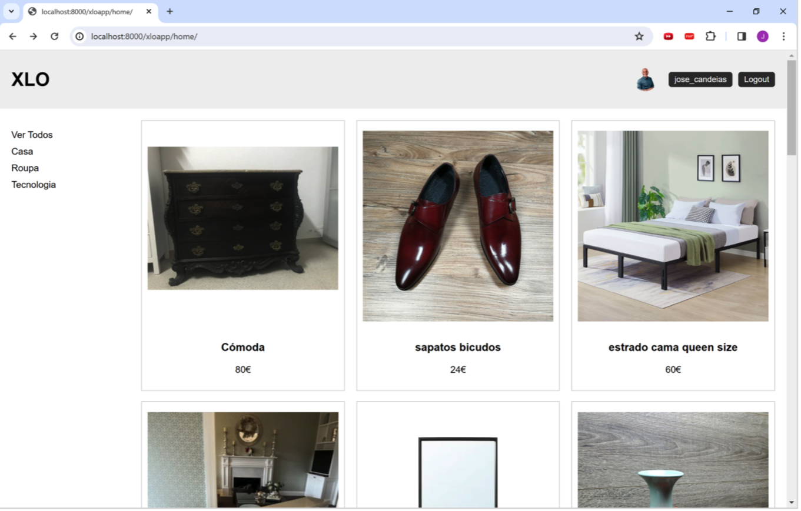
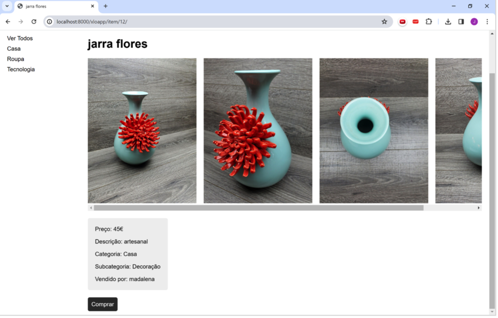
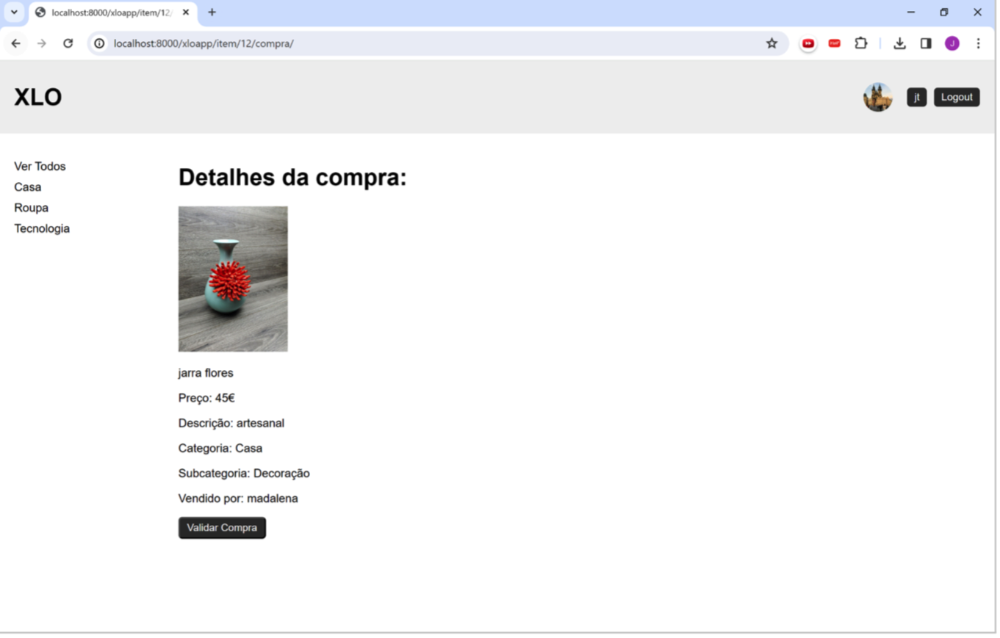
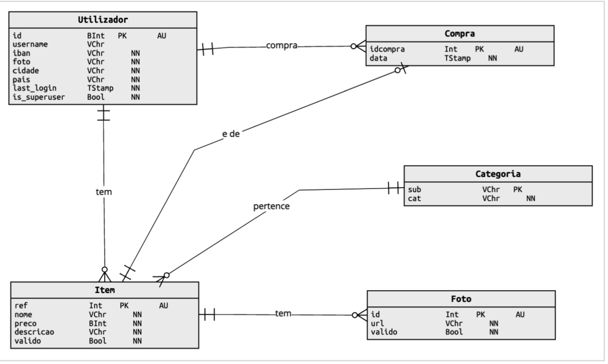
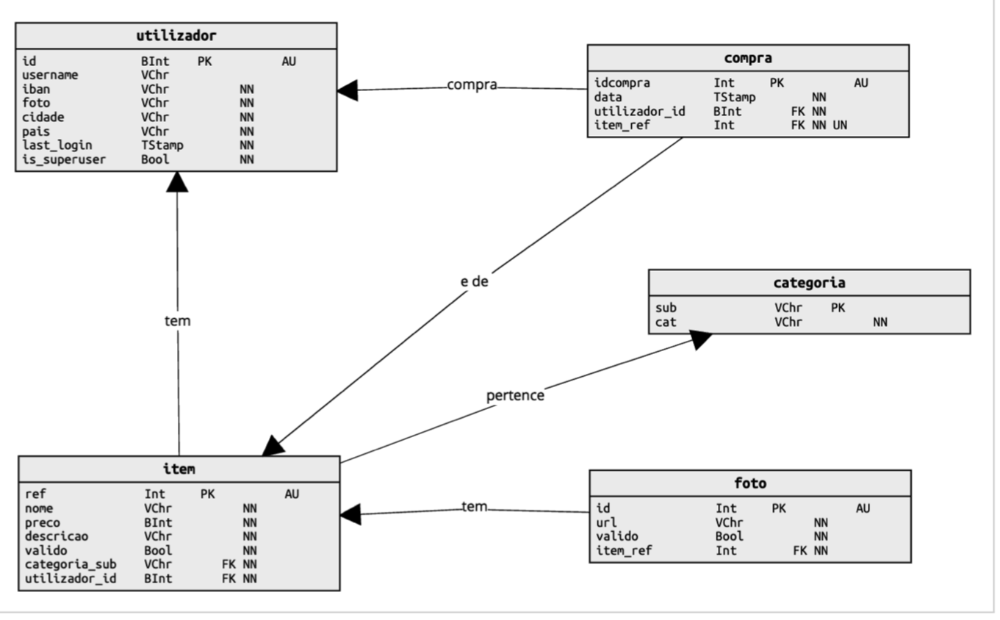

# XLO — second-hand marketplace

XLO is a web app for buying and selling second-hand items, built with **Django** and **PostgreSQL**. Users create an account, list items with photos, browse by category and buy items from other users. New listings must be approved by an admin before they appear.

It was developed as the course project for *Bases de Dados e Análise de Informação* (BDAI) at the University of Coimbra (January 2024) by **João Trovão** and **Madalena Trindade**.



## Features

- Sign up, log in and log out (custom Django user model with IBAN, profile photo, city and country)
- Browse approved items, newest first, filtered by category and sub-category
- Item pages with a scrollable photo gallery and seller details
- Buy an item: the purchase is recorded and the item stops being listed
- User profiles showing items for sale; on your own profile you also see your IBAN, sold items and an "Add item" button
- Admin moderation: new items are created as not approved (`valido = False`) and become visible once an admin approves them in the Django admin

| Item page | Purchase page |
|---|---|
|  |  |

## Data model

| Table | Purpose |
|---|---|
| `Utilizador` | Users; extends Django's `AbstractBaseUser` so it works with Django authentication |
| `Item` | Items for sale: name, price, description, approval flag, seller and sub-category |
| `Foto` | Photo URLs for an item |
| `Categoria` | Sub-categories (primary key) and their parent category |
| `Compra` | Purchases: buyer, item and timestamp |
| `Mensagem` | Messages between users (modelled, but the chat feature was not implemented) |

**ER diagram**



**Physical diagram**



## Running locally

Requirements: Python 3.9+ and, optionally, PostgreSQL.

```bash
python -m venv .venv
source .venv/bin/activate        # Windows: .venv\Scripts\activate
pip install -r requirements.txt
```

### Option A: quick start with SQLite

```bash
export USE_SQLITE=1
python manage.py migrate
python manage.py loaddata categorias   # sample categories
python manage.py createsuperuser
python manage.py runserver
```

### Option B: PostgreSQL

Create a database (e.g. `createdb xlo_bdai`), then set the connection details as environment variables (see [.env.example](.env.example)):

```bash
export DB_NAME=xlo_bdai DB_USER=postgres DB_PASSWORD=your-password
python manage.py migrate
python manage.py loaddata categorias
python manage.py createsuperuser
python manage.py runserver
```

Then open <http://localhost:8000/>.

- Create user accounts on the sign-up page.
- Approve new items (tick `valido`) and manage categories in the admin at <http://localhost:8000/admin/>.

### Tests

```bash
USE_SQLITE=1 python manage.py test xloapp
```

## Configuration

| Variable | Default | Description |
|---|---|---|
| `DJANGO_SECRET_KEY` | insecure dev key | Set a real secret in any non-local environment |
| `DJANGO_DEBUG` | `True` | Set to `False` outside development |
| `DJANGO_ALLOWED_HOSTS` | *(empty)* | Comma-separated host names |
| `USE_SQLITE` | *(unset)* | `1` uses a local SQLite file instead of PostgreSQL |
| `DB_NAME`, `DB_USER`, `DB_PASSWORD`, `DB_HOST`, `DB_PORT` | `xlo_bdai`, `postgres`, *(empty)*, `localhost`, `5432` | PostgreSQL connection |

## Limitations

This is a university project, not a production service:

- No real payments: buying an item only records the purchase in the database.
- Photos are stored as URLs rather than uploaded files.
- Prices are whole euros.
- The planned buyer/seller chat was not implemented.
- The interface is in Portuguese.

## Project structure

```
xlo/              Django project settings and root URLs
xloapp/
  models.py       Data model
  views.py        Page logic
  forms.py        Sign-up, add-item and purchase forms
  admin.py        Admin configuration (custom user admin)
  templates/      HTML templates
  static/         CSS and placeholder image
  fixtures/       Sample categories
  tests.py        Tests
docs/             Diagrams and screenshots used in this README
```
